<picture>
  <source media="(prefers-color-scheme: dark)" srcset="assets/man-dark.svg"/>
  
</picture>

I like building the thing between "that looks
interesting" and "it's running on my machine". Most of what's below started as
something I was annoyed by.

## The one I'm proudest of

### [breakinggood](https://github.com/eklavya2201/breakinggood) — one command, any URL

<a href="https://github.com/eklavya2201/breakinggood"></a>

Give it a GitHub link and it clones the repo, works out the stack, **reads the
dependencies before running them** (install scripts, brand-new packages,
`curl | bash` in hooks), fills in `.env`, installs and opens it in your browser.

Give it a website and it opens the page in your own Chrome, captures screenshots,
DOM, design tokens and every API response, then writes a Vite + React + Tailwind
project that looks the same and fetches data the same way, with a mock server
replaying what the real site sent back.

```bash
npx breakinggood https://github.com/someone/some-app   # clone, check, run
npx breakinggood https://some-website.com              # rebuild as React, run
```

<p>
  <a href="https://www.npmjs.com/package/breakinggood"></a>
  <a href="https://github.com/eklavya2201/breakinggood/stargazers"></a>
  <a href="https://github.com/eklavya2201/breakinggood/network/members"></a>
  <a href="https://github.com/eklavya2201/breakinggood/graphs/contributors"></a>
  <a href="https://github.com/eklavya2201/breakinggood/issues?q=is%3Aissue+is%3Aopen+label%3A%22good+first+issue%22"></a>
</p>

Also ships as an MCP server (`breakinggood mcp`), so Claude / Cursor can capture a
site or scan a repo as a tool call. CI runs on Linux, macOS and Windows.
**There are open good-first-issues if you want to help.**

| original | what it wrote |
| --- | --- |
|  |  |

## Other things I've built

<table>
<tr>
<td width="50%" valign="top">

**[TokenMeter](https://github.com/eklavya2201/Token-Meter)** · [live](https://tokenmeter.onrender.com)<br/>
LLM cost router. Scores how hard a prompt is, sends it to the cheapest model
that can handle it, caches repeats. 27.5% cheaper on a mixed benchmark. Drop-in
`/v1/messages` proxy with budget guardrails.<br/>
<sub>Python · FastAPI · SQLite</sub>

</td>
<td width="50%" valign="top">

**[AgentTrace](https://github.com/eklavya2201/AgentTrace)** · [live](https://agenttrace-t8y9.onrender.com)<br/>
Flight recorder for LLM agents. Every LLM call, tool call and decision with
tokens, cost and latency, replayable as a timeline.<br/>
<sub>Python · FastAPI · SQLite</sub>

</td>
</tr>
<tr>
<td width="50%" valign="top">

**[InterviewOps](https://github.com/eklavya2201/InterviewOPS)** · [live](https://interviewops.onrender.com)<br/>
AI mock interviewer that grades itself: adaptive technical screens plus an
LLM-as-judge pipeline that audits the interviewer, not just the candidate.<br/>
<sub>Python · FastAPI · LLM evals</sub>

</td>
<td width="50%" valign="top">

**[CricVision](https://github.com/eklavya2201/cricvision)**<br/>
YOLO player and ball detection on cricket footage with a scoreboard UI. Next up:
a hand-labelled dataset and a fine-tune with a real mAP table.<br/>
<sub>Python · YOLOv8 · PyTorch</sub>

</td>
</tr>
<tr>
<td width="50%" valign="top">

**[CarbonScope](https://github.com/eklavya2201/CarbonScope)**<br/>
Predicts CO2 emissions from transport and energy use.<br/>
<sub>Flask · scikit-learn · Chart.js</sub>

</td>
<td width="50%" valign="top">

**[monetary-flow](https://github.com/eklavya2201/monetary-flow)**<br/>
Rules-first NSE trading agent, backtested before it's allowed near money.<br/>
<sub>Python</sub>

</td>
</tr>
</table>

Outside GitHub I've worked on production AI at early-stage startups: voice
agents that run real sales and loan-document calls, and a fine-tuned code model
(Qwen2.5-Coder-14B + LoRA) that writes CAD for hardware.

---

<sub>[x.com/eklavya221](https://x.com/eklavya221) · [dev.to](https://dev.to/eklavya_pandey_163f26590b) · Mumbai</sub>

<sub>If you're stuck getting some repo to run, try `npx breakinggood <url>` and open an issue when it doesn't work. That's how it gets better.</sub>
